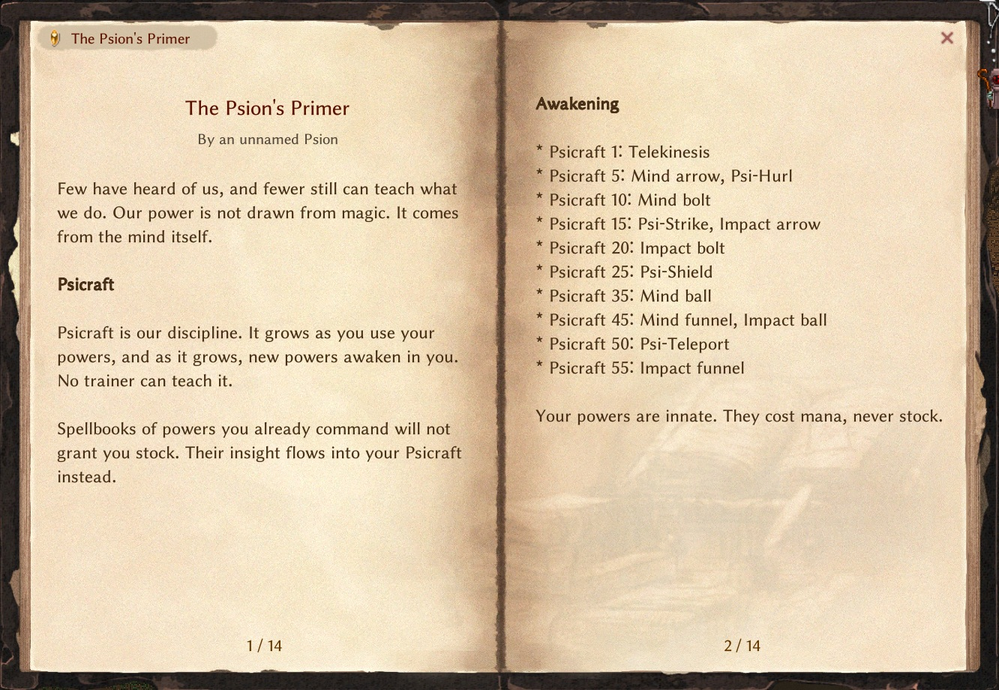
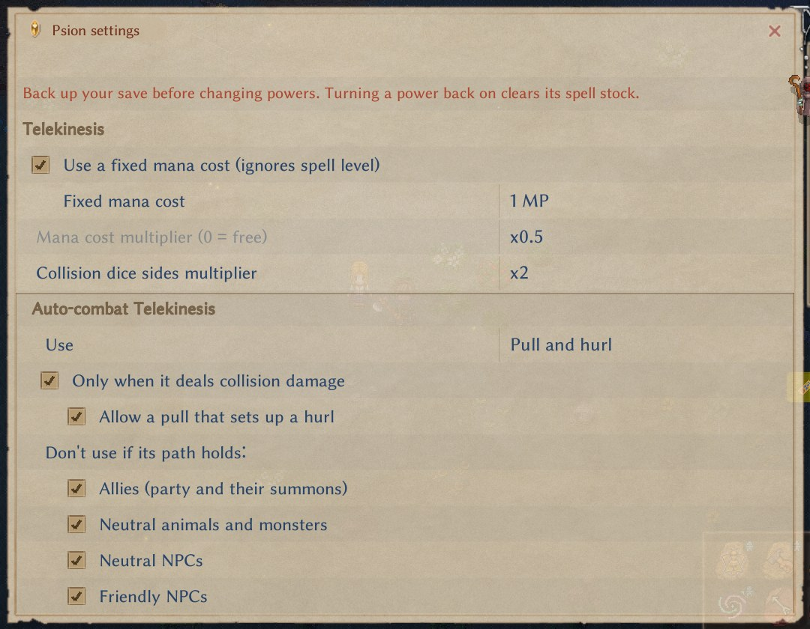
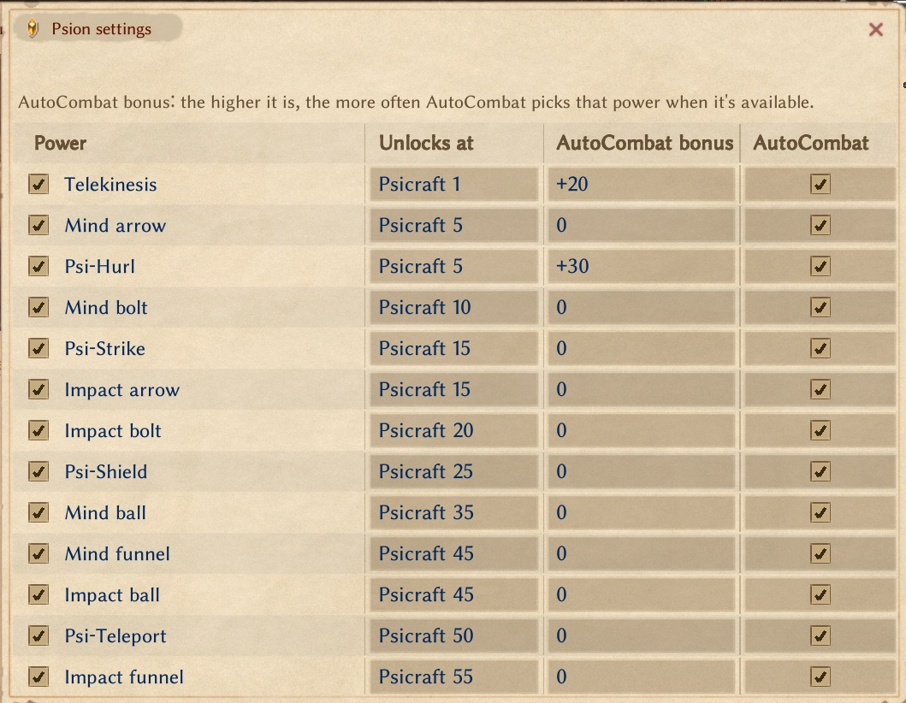

# PSI User Class [Beta]

This mod is in beta and under active testing. Expect bugs, and please report any you find. Testers welcome!

Adds a PSI user class, the Psion: a mystic who draws power from the mind, not magic. Fair warning: it's strong (no spell stock needed) and built for fun more than balance.

**How to use**

1. Create a character and pick Psion as your class (any race).
2. Read The Psion's Primer in your starting inventory. It explains everything.
3. Tune it any time: Character sheet > Strategy > Psion settings.

**What you get**

- Psicraft skill: powers awaken as it grows (Telekinesis, Mind and Impact spells, Psi-Shield, Psi-Teleport).
- Powers are innate: mana only, no spell stock.
- Stronger, cheaper Telekinesis, with smarter AutoCombat use.
- Psionic Edge trait: small bonus to harvesting and crafting.
- Catch: Mind damage you deal to the undead lashes back. The Necropathy feat fixes that.

**Settings**

- Switch any power off, or change the Psicraft level that unlocks it.
- Telekinesis cost, collision dice and AutoCombat rules.
- AutoCombat bonus per power, on top of any strategy.

Inspired by ADOM's Mindcrafter; all names, text and art are original. English, Japanese and Simplified Chinese. Japanese and Simplified Chinese translations: Claude (AI).

---

## 日本語

このModはベータ版で、現在テスト中です。不具合が予想されます。見つけた場合はぜひ報告してください。テスター歓迎！

サイ能力者のクラス「サイオン」を追加: 魔力ではなく精神から力を引き出す神秘家。注意: ストック不要のため強力です。バランスより楽しさ重視。

**使い方**

1. キャラクター作成でクラスにサイオンを選ぶ(種族自由)。
2. 所持品の「サイオン入門」を読む。全て解説しています。
3. いつでも調整可能: キャラクター画面 > 作戦 > サイオン設定。

**特徴**

- サイクラフト: 成長と共に能力が目覚める(テレキネシス、狂気・衝撃の呪文、サイシールド、サイテレポート)。
- 能力は生得: マナのみ消費、ストック不要。
- より強く安いテレキネシスと、賢い自動戦闘での使用。
- サイオニック・エッジ(特性): 採取と製作に小さなボーナス。
- 代償: アンデッドへの精神ダメージは跳ね返る。特技ネクロパシーで解消。

**設定**

- 能力ごとのオン/オフ、解放するサイクラフトのレベル。
- テレキネシスの消費、衝突ダイス、自動戦闘のルール。
- 能力ごとの自動戦闘ボーナス(どの作戦にも上乗せ)。

ADOMのマインドクラフターに着想。名称・文章・画像はオリジナル。英語・日本語・簡体字中国語対応。日本語・簡体字中国語の翻訳: Claude(AI翻訳)。

---

## 简体中文

本模组处于测试阶段,正在积极测试中。可能存在错误,发现问题欢迎反馈。欢迎参与测试!

新增灵能使用者职业「灵能者」: 力量源自精神而非魔力的秘术师。提醒: 无需储备使其相当强,重在好玩而非平衡。

**使用方法**

1. 创建角色时选择灵能者职业(任何种族)。
2. 阅读开局物品中的《灵能者入门》,其中讲解了全部内容。
3. 随时调整: 角色界面 > 战术 > 灵能者设置。

**内容**

- 灵能术: 随成长觉醒能力(念动术、精神与冲击法术、灵能护盾、灵能传送)。
- 能力与生俱来: 只消耗魔力,无需储备。
- 更强更省的念动术,以及更聪明的自动战斗使用方式。
- 灵能锋刃(特性): 采集与制作的小幅加成。
- 代价: 对不死者造成的精神伤害会反噬。专长死灵感应可解决。

**设置**

- 每个能力可开关,并可修改解锁所需的灵能术等级。
- 念动术的消耗、碰撞骰与自动战斗规则。
- 每个能力的自动战斗加成(叠加于任何战术)。

灵感来自ADOM的Mindcrafter;名称、文本与图像均为原创。支持英语、日语、简体中文。日语和简体中文译文: Claude(AI翻译)。
